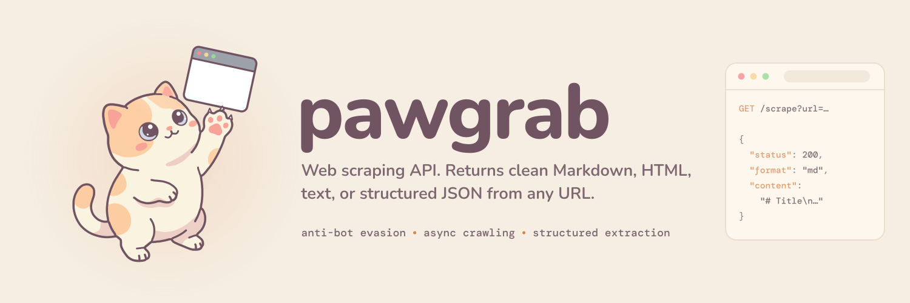

<p align="center">
  <picture>
    <source media="(prefers-color-scheme: dark)" srcset="assets/brand/pawgrab-banner-dark.svg">
    <source media="(prefers-color-scheme: light)" srcset="assets/brand/pawgrab-banner-light.svg">
    
  </picture>
</p>

<h1 align="center">Pawgrab</h1>

<p align="center">Web scraping API. Returns clean Markdown, HTML, text, or structured JSON from any URL.</p>

<p align="center">
  <a href="https://pypi.org/project/pawgrab/"></a>
  <a href="https://pypi.org/project/pawgrab/"></a>
  <a href="https://github.com/jaywyawhare/Pawgrab/actions/workflows/ci.yml"></a>
  <a href="docs/mcp.md"></a>
  <a href="https://github.com/astral-sh/ruff"></a>
  <a href="LICENSE"></a>
</p>


## Features

**Scraping**
- Single URL scraping with multiple output formats
- Async site crawling (BFS, depth/page limits, Redis job queue)
- Agentic extraction (`/agent`) — a bounded, multi-step agent that navigates and searches to satisfy a prompt + JSON schema, with `effort` budgets
- Live interactive sessions (`/scrape/{id}/interact`) — keep a page alive and drive it with code actions or an AI prompt, with a live view
- Content index — write-through cache of scraped pages, searchable and ranked without a live fetch (`/index/search`)
- Relevance-ranked site map — `/map` ranks discovered URLs against a `search` query

**Browser**
- Auto JS detection - curl_cffi first, Patchright fallback for JS-heavy pages
- Anti-bot evasion - TLS fingerprint impersonation, stealth browser profiles ([reproducible benchmark](docs/anti-bot.md))
- Proxy rotation with health checking

**Production**
- Per-domain and API-level rate limiting
- Robots.txt compliance
- Unified error responses with machine-readable error codes
- SSE heartbeats for reliable streaming through reverse proxies
- Idempotency keys for safe retries on crawl/batch endpoints
- Request ID correlation and response timing headers
- Docker Compose deployment (API + worker + Redis)

**AI / agents**
- MCP server (`pawgrab mcp`) exposing scrape, crawl, agent, search, map, index, and parse as tools — see [docs/mcp.md](docs/mcp.md)
- One-command setup (`pawgrab init`) that scaffolds `.env` and prints an MCP client config
- Skills catalog ([skills/](skills/)) and n8n/Zapier integrations ([integrations/](integrations/))
- 9 SDKs generated from one OpenAPI schema ([sdk/](sdk/))

## Benchmarks

End-to-end scraping, median of 5 runs, [books.toscrape.com](https://books.toscrape.com/), lower is better.

> Pawgrab extracts **article-quality content** via Readability while raw BS4/lxml return ALL page text (nav, footer, ads, etc). Pawgrab also adds TLS fingerprint impersonation + anti-bot evasion.

<p align="center">
  
</p>

### Extraction quality

Main-content extraction (word-F1 against hand-written ground truth), reproducible via `python -m benchmarks.compare` and `benchmarks/external/wcxb_runner.py`.

| benchmark | pawgrab | trafilatura | readability | goose3 |
|---|---:|---:|---:|---:|
| local dataset (6 cases) | **1.000** | 0.996 | 0.993 | 0.983 |
| WCXB dev (1,476 pages, 7 page types) | **0.832** | 0.777 | — | — |
| WCXB held-out test (505 pages) | **0.860** | — | — | — |

WCXB per-type (dev split): article 0.932 · documentation 0.915 · service 0.796 · listing 0.703 · collection 0.622 · forum 0.656 · product 0.596.

## Install

```bash
pip install pawgrab
patchright install chromium
```

## Quickstart

```bash
# Start Redis (needed for /crawl)
docker run -d -p 6379:6379 redis:7-alpine

# Configure
cp .env.example .env
# Set PAWGRAB_OPENAI_API_KEY if you need /extract

# Run
pawgrab serve
```

Or with Docker:

```bash
cp .env.example .env
docker compose up
```

## API

All endpoints are at the API root (`/scrape`, `/agent`, …).

### POST /scrape

```bash
curl -X POST http://localhost:8000/scrape \
  -H 'Content-Type: application/json' \
  -d '{"url": "https://example.com"}'
```

| Field | Type | Default | Description |
|-------|------|---------|-------------|
| `url` | string | required | URL to scrape |
| `formats` | array | `["markdown"]` | `markdown`, `html`, `text`, `json` |
| `wait_for_js` | bool/null | `null` | Force JS (`true`), skip (`false`), auto (`null`) |
| `timeout` | int | `30000` | Timeout in ms |

### POST /crawl

Returns job ID (HTTP 202). Poll with `GET /crawl/{job_id}`.

```bash
curl -X POST http://localhost:8000/crawl \
  -H 'Content-Type: application/json' \
  -d '{"url": "https://example.com", "max_pages": 5}'
```

Supports `Idempotency-Key` header for safe retries.

### POST /agent

Agentic, multi-step extraction (replaces `/extract`). Requires an LLM provider
(`PAWGRAB_OPENAI_API_KEY` or another). See [docs/agent.md](docs/agent.md).

```bash
curl -X POST http://localhost:8000/agent \
  -H 'Content-Type: application/json' \
  -d '{"prompt": "Extract the pricing tiers and monthly cost", "urls": ["https://example.com/pricing"], "effort": "medium"}'
```

### POST /scrape/live + /scrape/{id}/interact

Keep a page alive and drive it with code actions or an AI prompt; `live_view_url`
returns a live screenshot. See [docs/interact.md](docs/interact.md).

### POST /index/search

Search the content index of already-scraped pages — ranked, no live fetch. See
[docs/index-search.md](docs/index-search.md).

```bash
curl -X POST http://localhost:8000/index/search \
  -H 'Content-Type: application/json' \
  -d '{"query": "authentication api key", "k": 5}'
```

### POST /parse

Run raw HTML through the same extraction pipeline without fetching.

```bash
curl -X POST http://localhost:8000/parse \
  -H 'Content-Type: application/json' \
  -d '{"html": "<html><body><article><h1>Title</h1></article></body></html>"}'
```

### POST /search

Searches the web and scrapes each result in parallel.

```bash
curl -X POST http://localhost:8000/search \
  -H 'Content-Type: application/json' \
  -d '{"query": "python web scraping", "exclude_domains": ["pinterest.com"]}'
```

### GET /health

Returns `ok`, `degraded`, or `unhealthy` with per-component checks.

```bash
curl http://localhost:8000/health
```

### Error Responses

All errors return a consistent JSON shape:

```json
{
  "success": false,
  "error": "Human-readable message",
  "code": "machine_readable_code",
  "details": null,
  "request_id": "a1b2c3d4e5f6"
}
```

Error codes: `validation_error`, `invalid_api_key`, `rate_limited`, `robots_blocked`, `resource_not_found`, `timeout`, `fetch_failed`, `browser_unavailable`, `queue_unavailable`, `llm_unavailable`, `extraction_failed`, `search_failed`, `agent_failed`, `index_unavailable`, `session_expired`, `internal_error`.

### Response Headers

Every response includes:

| Header | Description |
|--------|-------------|
| `X-Request-ID` | Unique request identifier for correlation |
| `X-API-Version` | API version |
| `X-Response-Time` | Request duration (e.g. `42.3ms`) |
| `X-RateLimit-Limit` | Requests allowed per minute |
| `X-RateLimit-Remaining` | Requests remaining in current window |

## CLI

```bash
pawgrab scrape https://example.com
pawgrab scrape https://example.com --format text
pawgrab agent "Extract the main heading" --url https://example.com
pawgrab init --browser          # scaffold .env + print MCP config
pawgrab openapi -o sdk/openapi.json
pawgrab serve --port 8000 --reload
```

## Configuration

All settings via env vars with `PAWGRAB_` prefix. See [.env.example](.env.example) for the full list.

Key settings:

| Variable | Default | Description |
|----------|---------|-------------|
| `PAWGRAB_API_KEY` | empty | API key for Bearer auth (empty = no auth) |
| `PAWGRAB_RATE_LIMIT_RPM` | `60` | Per-domain rate limit (requests/min) |
| `PAWGRAB_API_RATE_LIMIT_RPM` | `600` | API-level rate limit per client (requests/min) |
| `PAWGRAB_REDIS_URL` | `redis://localhost:6379/0` | Redis for job queue and idempotency |

## License

[DBaJ-GPL v69.420](LICENSE)
